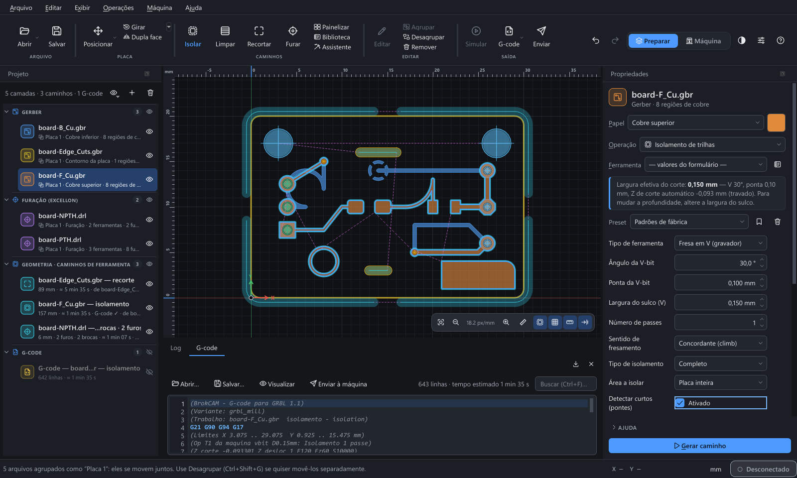
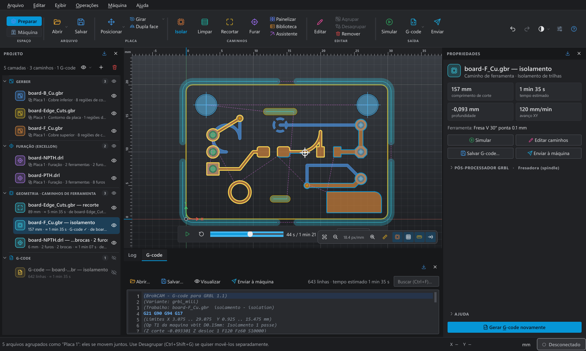
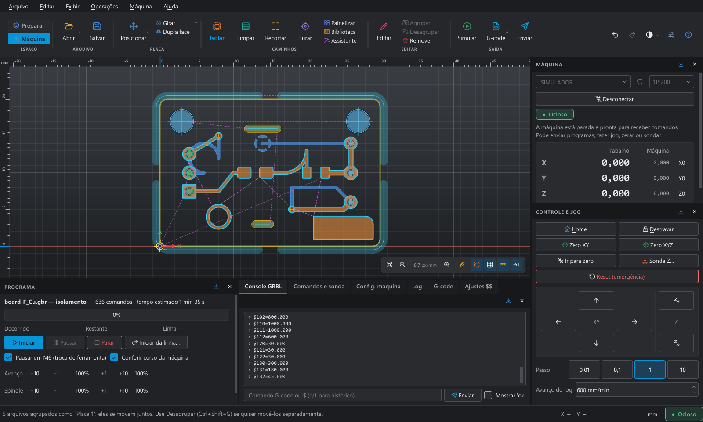
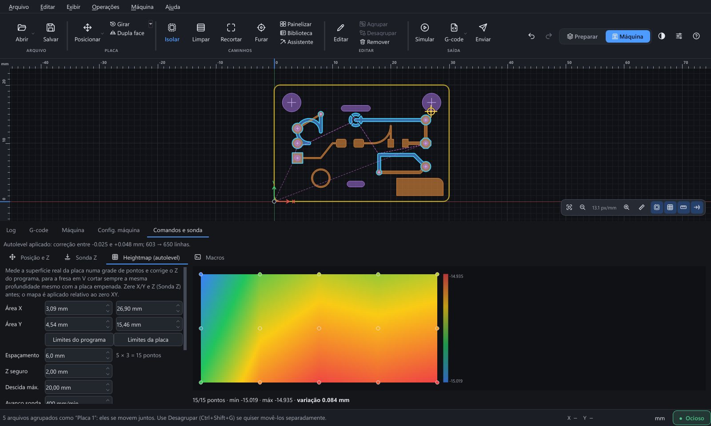
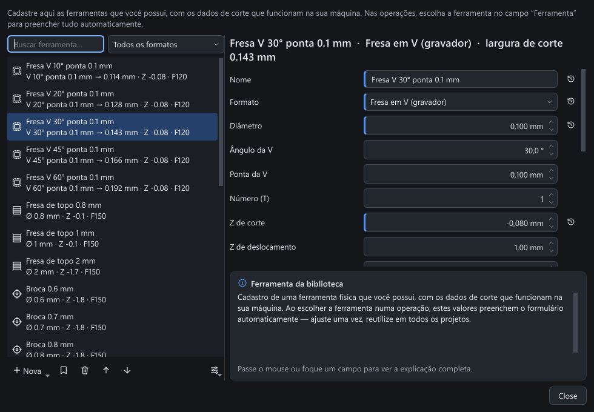
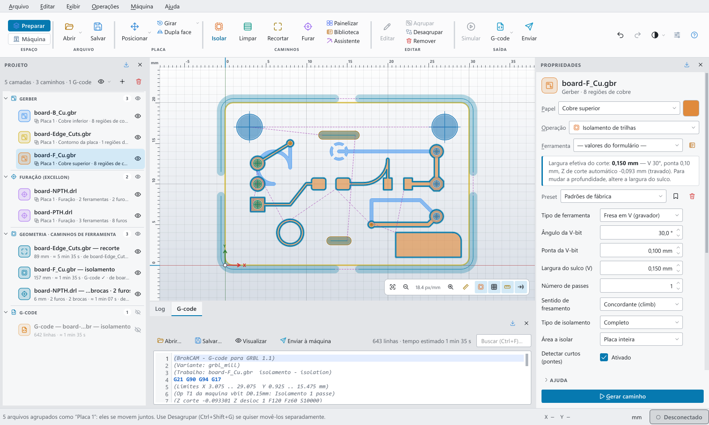

# BrokCAM

**Do Gerber à placa fresada: um CAM para fabricar PCBs em casa com fresadoras e lasers GRBL.**




O BrokCAM lê os arquivos de fabricação que qualquer software de PCB exporta (KiCad, Eagle,
EasyEDA…), gera os caminhos de ferramenta — isolamento de trilhas, limpeza de cobre, furação e
recorte — converte tudo em G-code para **GRBL 1.1** e envia o programa à máquina pela USB ou
pelo WiFi. É um único programa para o caminho inteiro, do arquivo ao cobre cortado.

## Por que existe

Fazer PCB caseira em CNC normalmente exige três ou quatro programas: um CAM para gerar o G-code,
um sender para mandar à máquina, planilhas para calcular profundidade da fresa em V e muita
tentativa e erro com os parâmetros `$$` do GRBL. O BrokCAM nasceu da engenharia reversa do
fluxo do FlatCAM com outra proposta:

- **Tudo explicado.** Cada opção tem ajuda em português dizendo *o que faz* e *por que importa*.
  Erros e alarmes do GRBL viram mensagens com causa provável e o que fazer.
- **Difícil de errar.** Valores perigosos são calculados ou limitados pelo software (o Z da fresa
  em V, por exemplo, sai da largura do sulco e não pode ser digitado à mão).
- **Rápido.** Geometria vetorizada com shapely 2/GEOS: ~0,7 s para ler 20 mil primitivas Gerber.
- **Feito para a bancada.** Pensado para máquinas reais como a MKS DLC32 (Grbl_Esp32), com
  assistente de configuração, teste de fins de curso e autolevel.

## Recursos

### Preparar
- **Abrir Gerber RS-274X/X2 e Excellon** por arrastar e soltar; o papel de cada arquivo (cobre
  superior/inferior, contorno, furação) é detectado sozinho e os arquivos da mesma placa andam juntos.
- **Isolamento de trilhas** com fresa em V ou de topo, vários passes e aviso de curtos entre trilhas.
- **Limpeza de cobre (NCC)**, **recorte com pontes**, **painelização** e **placas dupla face**.
- **Furação por diâmetro:** cada diâmetro com cor própria e furo no tamanho real; tabela com
  contagem por broca; um G-code por broca com um clique — ou **escolha a broca de cada
  diâmetro** (vários diâmetros → uma broca real, como no FlatCAM) e gere tudo num só G-code,
  com uma troca por broca.
- **Abrir G-code como projeto:** arquivos `.nc`/`.gcode` (do BrokCAM, FlatCAM ou outro CAM) viram
  caminhos editáveis + geometria — mova com a placa, edite caminhos, troque profundidade/avanço/
  rotação e gere o G-code de novo.
- **Biblioteca de ferramentas** e **presets** com os dados de corte que funcionam na sua máquina.
- **Edição manual de caminhos**: excluir, apagar trecho, inverter sentido, reotimizar a ordem.
- Desfazer/refazer em tudo que altera o projeto.
- **Interface no estilo CAD** (Fusion 360 / Inventor): temas Claro, Escuro, Grafite, Azul-aço,
  Meia-noite e Alto contraste, cor de destaque à escolha (inclusive personalizada), fundo em
  degradê, ícones coloridos, cantos e densidade ajustáveis — tudo com contraste AA.

### Gerar
- Pós-processador **GRBL 1.1** (fresadora, laser `$32=1`, sem troca de ferramenta) com offset Z.
- Otimização de percurso (vizinho mais próximo + 2-opt) para reduzir deslocamentos em vazio.
- **Simulação** do G-code com estimativa de tempo antes de cortar.

### Cortar
- Conexão por **USB** ou **WiFi** (`tcp://192.168.4.1:23`), ou o **simulador** embutido para
  testar sem hardware.
- Envio com controle de fluxo por contagem de caracteres (buffer de 128 bytes), pausa/retomada e
  overrides de avanço e rotação.
- Jog, zeragem, **sonda Z** e **heightmap (autolevel)**: sonda uma grade sobre a placa e corrige
  o Z pela superfície real — essencial para isolamento em placa empenada.
- **Assistente de configuração da máquina**: testa ao vivo fins de curso, direção dos eixos e
  homing, faz cópia de segurança do `$$` e diz onde está o erro.
- Edição explicada de todas as configurações `$$` e das estendidas do **Grbl_Esp32 / MKS DLC32**.

## Capturas de tela

| Simulação do G-code | Painel da máquina |
|---|---|
|  |  |
| **Heightmap (autolevel)** | **Biblioteca de ferramentas** |
|  |  |

Temas escuro, claro e alto contraste: 

## Como usar

1. **Abrir** os Gerbers e Excellons da placa.
2. **Operação:** escolha Isolar, Limpar, Furar ou Recortar e clique em *Gerar caminho*.
3. **G-code:** gere, confira na simulação e salve ou envie.
4. **Máquina:** conecte, zere X/Y/Z (ou sonde), opcionalmente faça o heightmap e envie.

Atalho para iniciantes: *Operações → Assistente "Gerber → GRBL em 4 passos"*.

## Instalação

### Executável (mais fácil)

Baixe `BrokCAM-<versão>-windows-x64.zip` em
[Releases](https://github.com/joao-goncalves-eng/BrokCAM/releases), extraia e abra
`BrokCAM\BrokCAM.exe` — não precisa instalar Python. Na primeira vez o Windows SmartScreen pode
avisar "editor desconhecido" (o executável não é assinado): clique em *Mais informações → Executar
assim mesmo*.

Para gerar o executável a partir do código: `GerarExecutavel.bat` (cria `dist\BrokCAM\` e o
`.zip`, e testa o resultado).

### A partir do código

Requer **Python 3.11** no Windows (o código também roda em Linux, mas o foco atual é Windows).

```powershell
git clone https://github.com/joao-goncalves-eng/BrokCAM.git
cd BrokCAM
python -m venv .venv
.venv\Scripts\pip install -r requirements.txt
.venv\Scripts\python.exe run.py
```

Depois da primeira instalação basta dar duplo clique em `BrokCAM.bat` — ou rode `CriarAtalho.bat`
uma vez para ter o BrokCAM com ícone próprio na Área de Trabalho e no Menu Iniciar.

## Arquitetura

Camadas com dependência em um só sentido; só a interface conhece o Qt, e as funções de CAM são
puras (`camada + parâmetros → Job`), o que permite testá-las sem tela.

```
brokcam/ui/        PySide6: janela, canvas, painéis, temas, console GRBL
brokcam/machine/   controlador GRBL (serial/TCP), códigos explicados, simulador
brokcam/gcode/     pós-processador GRBL, interpretador para preview, autolevel
brokcam/cam/       isolamento, NCC, recorte, furação, painelização, otimização
brokcam/parsers/   Gerber RS-274X/X2, Excellon, detecção de papel
brokcam/core/      modelo de dados (mm), parâmetros documentados (ParamSpec)
```

**Stack:** Python 3.11 · PySide6 (Qt 6) · shapely 2 · numpy · pyserial · pytest.
**Tamanho:** ~25 mil linhas de código e ~4 mil de testes (327 testes, incluindo testes de
interface em modo offscreen e cenários de máquina no simulador).

Detalhes em [ARCHITECTURE.md](ARCHITECTURE.md).

### Rodar os testes

```powershell
$env:QT_QPA_PLATFORM="offscreen"
.venv\Scripts\python.exe -m pytest -q --ignore=tests/test_ui_screenshots.py
```

## Estado do projeto

Versão **0.3.0** — em desenvolvimento ativo. Veja o [histórico de versões](CHANGELOG.md) e
[como as versões são numeradas](docs/VERSIONAMENTO.md).

> ⚠️ Conexão e leitura de configurações já foram testadas numa MKS DLC32 real, mas envio de
> programa, sonda e heightmap até agora só foram validados no simulador. Faça um corte de teste
> numa sobra de placa antes do primeiro uso.

### Próximos passos
- [ ] Validar o fluxo completo cortando placas reais
- [ ] Importar DXF, SVG e PDF
- [ ] Furos fresados em hélice
- [ ] Instalador `.exe` (PyInstaller) para usar sem Python
- [ ] Desfazer também para mudanças de parâmetros; salvar G-code dentro do projeto

## Créditos

O fluxo de trabalho foi estudado a partir do [FlatCAM](http://flatcam.org) 8.994
(MIT — Juan Pablo Caram e Marius Stanciu). O BrokCAM é código novo, com outra arquitetura;
nenhum código do FlatCAM é distribuído neste repositório.

## Autor

**João Antônio Gonçalves** — estudante de Engenharia Mecatrônica.
Projeto que junta as áreas que mais me interessam: eletrônica, mecânica e programação.

## Licença

[MIT](LICENSE).

---

<details>
<summary><b>English summary</b></summary>

BrokCAM is a desktop CAM for making printed circuit boards at home on GRBL 1.1 CNC routers and
lasers. It reads Gerber and Excellon files, generates isolation, copper-clearing, drilling and
cutout toolpaths, post-processes them to GRBL G-code and streams the program to the machine over
USB or WiFi, with probing, heightmap autoleveling and a guided machine-setup wizard. Written in
Python 3.11 with PySide6 and shapely 2. The interface is in Brazilian Portuguese. MIT licensed.
</details>
